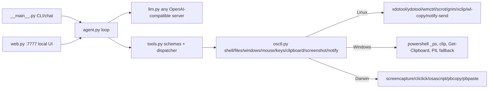

Back to [[Home]]

# jev_x/ internals (the cross-platform brain)

- Pure Python stdlib except one lazy, undeclared dependency: `from PIL import ImageGrab/Image` inside `osctl.py` (screenshot/screen_size fallback only — not a top-level import, so packagers must be told about it explicitly).
- Config: `~/.config/jev-x/config.json` or env `JEV_X_BASE_URL` / `JEV_X_API_KEY` / `JEV_X_MODEL` — any OpenAI-compatible endpoint, no code change to switch.
- Safety: blocks catastrophic commands (`rm -rf /`, `mkfs`, `dd` to disk, shutdown, fork bomb) unless `JEV_X_UNSAFE=1`. Web UI binds `127.0.0.1` only.
- Known limits (from README-X.md, not changed today): model is text-only (no screenshot vision, drives GUI blind via windows/shell/keys); Wayland needs `ydotool`+daemon or XWayland+`xdotool`; Windows/macOS osctl backends exist in code but were untested before today; not ported from the Mac app: overlay, hotkey, wake word, Whisper dictation, meetings, learned shortcuts.
